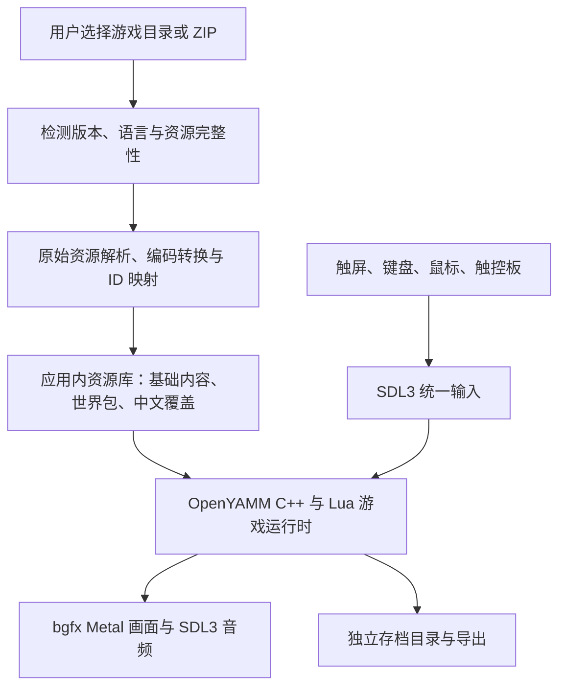

**OpenYAMM 移植 iPadOS：源码审查与实施方案**

审查日期：2026-09-06。上游：[pjasicek/openyamm](https://github.com/pjasicek/openyamm)。审查基线为 main 的提交 [`db142fb3f38fb59be7f5a50a393dbe4377772bbe`](https://github.com/pjasicek/openyamm/commit/db142fb3f38fb59be7f5a50a393dbe4377772bbe)，提交日期 2026-09-01。

结论：值得做原生 iPadOS 移植。C++20、SDL3、bgfx、PhysicsFS 和 Lua 构成了可移植基础，Android 端已有移动操作方案。用户已接受 MM678 整合版路线，因此首版沿用上游共享基础数据和整合玩法，不再要求三部单作分别独立运行。“iPad 能运行引擎”“用户导入资源”“汉化版内容兼容”仍是不同的工程任务。

本次完成源码与官方平台资料审查，没有编译或在 iPad 上运行，未验证任何具体汉化发行版，也没有作出帧率或全流程通关保证。源码保存在临时研究目录，当前工作区只新增本方案。

当前目标：应用不预装商业游戏内容；用户自行提供资源并导入，接受 MM678 整合版；中文内容包括剧情、任务、物品、技能和界面；支持触屏、外接键盘、鼠标与触控板；游戏在 iPad 本地执行。首版以 OpenYAMM 的玩法实现为基线。三部原版完整安装目录足以开始资源审计，但并不必然包含 MMMerge 的扩展表、重映射和补充资源；若有已安装且可运行的 MMMerge 完整目录及对应汉化版本，也应一并提供供审查。具体缺项由导入审计列出。

| 需求 | 源码审查结论 | 判断 |
| --- | --- | --- |
| iPad 本地运行 | 底层库存在苹果平台支持；仓库未提供可直接使用的 iPadOS 构建 | 技术可行，需平台移植 |
| 外接键盘 | 已有 SDL 按键状态、按键计数和可配置键位 | 可复用，需真机验证 |
| 鼠标和触控板 | 桌面端已有相对移动与左右键；Android 分支将相对移动清零 | 可实现，需重新组织移动端输入策略 |
| 触屏 | Android 已有移动摇杆、视角拖动、物品拖放等 | 可复用，需 iPad 布局与外设共存适配 |
| 导入原版游戏文件 | 当前运行时主要加载转换后的目录和 ZIP；已有零散导出工具 | 需要新增完整导入流水线 |
| MM678 整合运行 | 沿用上游共享基础层；三部原版文件与整合所需内容并不等同 | 符合上游架构，需验证输入资源完整性 |
| 汉化版内容 | 正文按单字节绘制，部分导入脚本以 CP1252 兜底 | 需要编码、字体、排版、ID 映射共同改造 |

上游 README 声明支持 Windows、Linux、Android，并称三代剧情、任务和核心系统已实现。这是上游状态说明，本次没有独立验证其完整通关质量。[上游 README](https://github.com/pjasicek/openyamm/blob/db142fb3f38fb59be7f5a50a393dbe4377772bbe/README.md)

源码中最影响方案的证据如下。

| 位置 | 已核实事实 | 对移植的影响 |
| --- | --- | --- |
| [BgfxRuntime.cmake](https://github.com/pjasicek/openyamm/blob/db142fb3f38fb59be7f5a50a393dbe4377772bbe/cmake/BgfxRuntime.cmake) | Metal 后端被设为 0；APPLE 着色器目标仍为 osx/glsl；非 Android 分支查找桌面 OpenGL | 需要独立 iOS 分支、Metal 实现与苹果框架链接 |
| [openyamm_shaderc_stubs.cpp](https://github.com/pjasicek/openyamm/blob/db142fb3f38fb59be7f5a50a393dbe4377772bbe/tools/openyamm_shaderc_stubs.cpp#L36) | Metal 编译函数是返回失败的占位实现 | 必须提供真正支持 Metal 的宿主机 shaderc，不能只打开渲染宏 |
| [BgfxContext.cpp](https://github.com/pjasicek/openyamm/blob/db142fb3f38fb59be7f5a50a393dbe4377772bbe/engine/BgfxContext.cpp#L24) | 默认选择 OpenGL；有 Cocoa 分支，但未建立 iOS UIView/Metal 图层接入 | 补齐窗口创建、原生句柄、尺寸及生命周期 |
| [Ffmpeg.cmake](https://github.com/pjasicek/openyamm/blob/db142fb3f38fb59be7f5a50a393dbe4377772bbe/cmake/Ffmpeg.cmake) | 交叉编译显式覆盖 Android；运行时裁剪为 Ogg/Theora/Vorbis 等组件 | 增加 iPhoneOS/Simulator 工具链，原始视频导入另需处理 |
| [AssetFileSystem.cpp](https://github.com/pjasicek/openyamm/blob/db142fb3f38fb59be7f5a50a393dbe4377772bbe/engine/AssetFileSystem.cpp#L817) | 挂载 engine.zip、worlds/*.zip，存在跨世界资源合并 | 资源包挂载可复用，原版目录不能直接当成此类资源包 |
| [AGENTS.md](https://github.com/pjasicek/openyamm/blob/db142fb3f38fb59be7f5a50a393dbe4377772bbe/AGENTS.md) | 定义共享 engine 基础层，MM6/7/8 世界不持有独立活动玩法表 | 不能简单删除另两部世界就认定单作独立支持完成 |
| [GameplayHudCommon.cpp](https://github.com/pjasicek/openyamm/blob/db142fb3f38fb59be7f5a50a393dbe4377772bbe/game/ui/GameplayHudCommon.cpp#L1471) | 256 字形索引、逐字节测宽/绘制、pop_back 截断、按空格换行 | 会破坏中文多字节字符，需统一文本链路 |
| [export_mm6_world_tables.py](https://github.com/pjasicek/openyamm/blob/db142fb3f38fb59be7f5a50a393dbe4377772bbe/tools/export_mm6_world_tables.py#L63) | UTF-8 失败后按 CP1252 解码并替换错误 | GBK/Big5 等中文资源不能依赖当前兜底逻辑 |
| [GameInputSystem.cpp](https://github.com/pjasicek/openyamm/blob/db142fb3f38fb59be7f5a50a393dbe4377772bbe/game/app/GameInputSystem.cpp#L103) | 触摸处理受 Android 宏限制；Android 相对鼠标量被清零 | 应按设备能力及输入模式组织逻辑，而非把 iPad 全部套进 Android 分支 |

FreeType 已在依赖配置中出现，但本次没有在 engine/game 正文渲染中找到其调用，因此“依赖中已有 FreeType”不能证明中文游戏文本已经可用。[依赖配置](https://github.com/pjasicek/openyamm/blob/db142fb3f38fb59be7f5a50a393dbe4377772bbe/cmake/Dependencies.cmake)

推荐架构为原生 iPad 应用：UIKit 负责文件选择、资源库和系统生命周期；通过少量 Objective-C++ 接入现有 C++ 游戏库；SDL3 管窗口、输入和音频，bgfx 使用 Metal。保留现有 Lua 解释执行路线，不需要运行 Windows EXE 或依赖 JIT。

SDL3 提供 iOS 接入与 Metal UIView 创建接口，bgfx 官方列出 iOS/iPadOS 支持。建议首版暂以 iPadOS 17+、横屏为目标，用 M 系列 iPad 做首台验证设备；这属于降低适配范围的产品选择，不是已测得的最低硬件要求。较旧 A 系列设备支持范围通过后续性能测试决定。[SDL3 iOS 文档](https://wiki.libsdl.org/SDL3/README-ios)、[SDL Metal UIView](https://wiki.libsdl.org/SDL3/SDL_Metal_CreateView)、[bgfx 平台列表](https://bkaradzic.github.io/bgfx/overview.html)

需要增加 iPadOS 应用目标、Info.plist、签名配置及 iPhoneOS/Simulator 依赖构建。Metal 工作包括渲染后端、UIView/CAMetalLayer 接入、宿主机着色器工具、着色器包查找路径，以及菜单/室内/室外等加载路径的一致改造。使用 SDL 主回调或适当的平台回调处理主循环，补齐进入后台、恢复、音频中断、低内存、窗口尺寸与 Retina 坐标转换。

资源导入可选三种实现路径。

| 路径 | 用户操作 | 优点 | 代价与适用范围 |
| --- | --- | --- | --- |
| A：iPad 内解析并生成资源包，最终推荐 | 在“文件”中选择已安装游戏目录或 ZIP，完成导入后直接玩 | 最符合需求，可完全在 iPad 管理资源 | 要实现原始资源解析、转换、依赖检查和失败恢复 |
| B：电脑预处理后导入，作为首阶段 | 在 Mac/Windows 转换自己的资源，再把生成的包导入 iPad | 可先验证引擎、输入和中文显示，转换便于调试 | 仍需电脑准备资源，只是过渡交付；不自动解决单作依赖问题 |
| C：运行时直接读取旧格式 | 导入原始目录，游玩过程中即时读取 | 可减少部分转换和重复存储 | 需扩展旧归档、视频、事件等读取链，长期维护面更大，不建议首版采用 |

选择 A 作为最终交付，按 B → A 的顺序落地。B 阶段可以用用户已有、来源明确的转换后整合资源验证运行；随后将确认可重复的导入流程迁入 iPad 应用。资源范围固定为经验证的 MM678 整合配置。

导入器先支持已安装游戏的目录或该目录的 ZIP；安装 EXE、光盘镜像解析另列后续范围。通过文件签名和资源目录内容检测 MM6/7/8 与语言，按版本配置处理 LOD/SND/VID 等容器、贴图、音效、表格和地图，复用并整理已有场景及 EVT/STR 转换工具。部分工具当前假设资源已解包且共享表已准备好，需要改成可重复、无外部开发目录依赖的流水线。

视频先沿用项目的 OGV 播放路径；电脑转换阶段可使用已有 SMK/BIK 转码脚本。iPad 内导入阶段需要把对应解码/转码能力编译成库，或实现经过测试的原格式播放；不能在 iPad 直接运行仓库的 shell/Python 工具。进入后台中断导入时应允许恢复，先在临时目录生成并校验，再原子切换到可用资源包。

从系统文件选择器获得访问权限后，将运行所需内容持久化到 Application Support；存档保存在独立持久目录并提供导出。大文件从 iCloud 或外接磁盘读入时显示进度和空间需求；可重建的临时内容才放 Caches。采用导入副本可使游戏在来源盘移除后继续运行。苹果文档提供文件夹选择及 security-scoped URL 的访问方式。[Apple 文件夹访问](https://developer.apple.com/documentation/uikit/providing-access-to-directories)

整合资源审计需要区分引擎自有资源、三部原版资源及 MMMerge 扩展资源，保留上游共享表和原始 ID → 内部 ID 映射，确保游戏逻辑不以翻译后的名称识别对象。验证角色创建、职业技能、物品纸娃娃、声音、商店、任务、跨大陆切换与存档。三部原版文件只是输入的一部分，不能以简单拼接三个目录代替整合转换；任何缺少的扩展内容都要列出来源和准备方式。单作独立配置暂不列为首版验收要求。

汉化支持采用“稳定数据标识 + UTF-8 内容 + 中文字体”的方式。第一批锁定具体汉化发行版，建立版本/语言配置，处理其实际使用的 GBK、GB18030、Big5 或 UTF-8；检测不明确时给出语言选择，保留原文件并报告解码错误。避免以错误替换字符生成看似成功的资源包。

正文渲染改为 Unicode 码点索引与按需字形缓存，接入 FreeType 或 CoreText，并处理中文换行、标点禁则、测宽、截断、缩放和字体回退。中文与数字混排、长任务描述、商店提示、技能说明、地图名称、存档名和中文输入法都需要检查。仅把文本转成 UTF-8，仍不能解决当前逐字节布局与删除的问题。

本地化资源通过稳定的世界/表/行 ID 或明确映射覆盖显示文本，同时保留数值和事件语义。原版汉化 DLL、EXE 补丁不会在新的 C++ 引擎中执行；其中的文字、图片与语音资源可以按格式提取，若补丁修改运行逻辑则必须逐项实现对应行为。因此目标应是“支持经验证的具体汉化版本”，不能承诺所有汉化补丁直接通用。

键鼠和触控板优先走 SDL3。需要时补充 GameController/UIKit 接口，避免同一物理输入由两条链路重复注入。探索视角采用相对移动和指针锁定，进入背包、对话或系统文件选择器时释放锁定；保留传统指针操作模式。处理左右键、滚轮/双指滚动、拖放、组合键、自定义键位、无 Esc/F 区键盘的替代绑定、设备断连和焦点丢失后的按键释放。触屏沿用 Android 摇杆及交互，外设接入后可隐藏触屏按钮，并保留手动切换。[Apple 键鼠游戏输入](https://developer.apple.com/videos/play/wwdc2020/10617/)、[Android 操作说明](https://github.com/pjasicek/openyamm/blob/db142fb3f38fb59be7f5a50a393dbe4377772bbe/android/showcase/README.md)

实施按以下阶段推进，每阶段交付可验证的结果。

| 阶段 | 主要工作 | 验收条件 |
| --- | --- | --- |
| 0：资源与依赖验证 | 固定源码基线；准备三部原版或完整整合版资源及汉化样本；整理资源转换输入输出 | 列清整合扩展资源缺项，形成可重复的转换流程，选择首张验证地图 |
| 1：iPad 最小运行闭环 | SDL3/Metal、依赖交叉编译、应用入口、读转换后资源、键鼠、存读档 | 真机进入一张室外地图和一张室内地图；移动、视角、交互、战斗及重启读档有效 |
| 2：整合资源导入 | 完整导入流程、进度、校验、持久目录和版本识别 | 清空资源库后导入已验证的整合配置即可开新档，缺项有明确诊断 |
| 3：中文完整链路 | 编码适配、字形缓存、断行、文本覆盖、中文输入 | 指定汉化版本的对话、任务、物品和技能正常显示；译文不破坏事件 ID |
| 4：验证 MM6/7/8 世界 | 世界可用性、跨大陆旅行、设备切换与音视频 | 三部世界均可进入和游玩，跨大陆后共享队伍、任务与存档状态正确 |
| 5：稳定性与交付 | 真实设备性能、长时运行、后台恢复、导入取消与恢复、存档导出和回归 | 按设备列出实测帧率/内存与已知问题；主线与支线覆盖记录可追踪 |

建议先用 MM8 的室内外地图验证平台，因为项目从其引擎和共享事件基础发展而来；随后覆盖 MM6、MM7 地图及跨大陆旅行。首版保留整合玩法，不再进行三部原版独立模式的资源与规则拆分。

初始性能目标可设为室内外持续 30 FPS、操作响应稳定，再评估 60 FPS 与更高画质；它们是待验收目标。应分别记录最低支持设备和参考设备的数据，首版保持原始资源或较低缩放档，控制纹理、视频与地图缓存。

工作量只能给条件性估计：原方案按“2–4 周验证原型、完整需求约 3–6 个月量级”规划。接受整合版减少了独立模式拆分工作，但尚未拿到资源和完成真机验证，因此暂不据此承诺缩短到某个确定工期。具体汉化补丁差异和三部游戏的全流程回归仍可能显著延长周期，应在阶段 0、1 完成后重新估算。

本机当前激活的开发目录是 `/Library/Developer/CommandLineTools`，`xcrun --sdk iphoneos --show-sdk-path` 未找到 iPhoneOS SDK。开始实际构建前需要安装或切换到带 iOS SDK 的完整 Xcode，并配置真机签名；本次没有修改工具链或签名设置。下一阶段所需信息是 iPad 型号/iPadOS 版本、三部游戏或整合版完整目录，以及汉化版本名称与文件。平台空场景验证不依赖完整游戏资源，可以与资源审计分别推进。

公开发布前还需要解决一个已存在的项目条件：上游 README 明示尚未声明许可证。应先向作者确认移植与再分发授权，再确定 IPA、TestFlight 或商店发行范围；不捆绑商业游戏资源也不能替代对引擎本身许可的确认。第三方依赖和字体的分发条件应随最终构建配置核对。本次未联系作者或发布任何内容。[上游许可说明](https://github.com/pjasicek/openyamm/blob/db142fb3f38fb59be7f5a50a393dbe4377772bbe/README.md#license)
