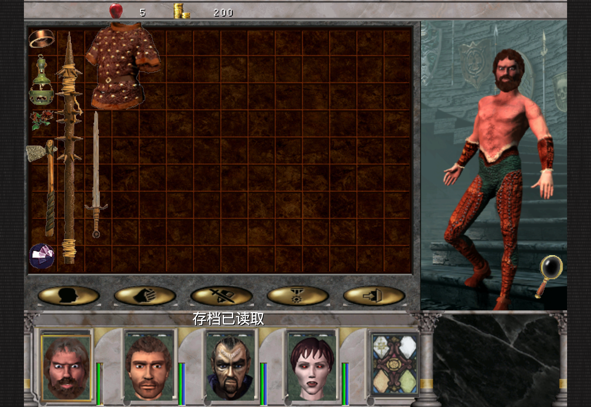
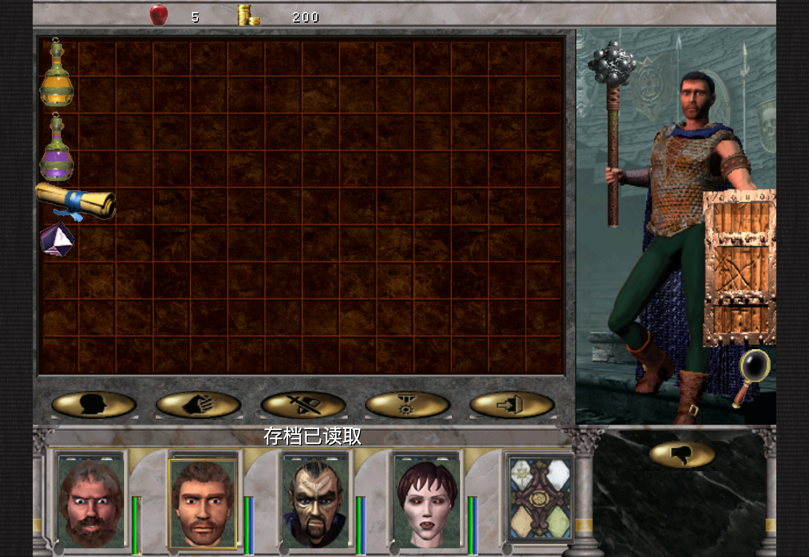

# 229：左臂姿态与遮挡集中修复

将原版三种左臂姿态和锚点恢复为一份共享显示结果，两条渲染路径共同消费。默认下垂臂使用LHd/LHo、握持臂使用LHu/LHc、伸出臂使用LHo/LHf。早层位于护甲之前；只有原Sword/Dagger副手需要晚层握持。源Weapon1or2对应原EquipStat0，Weapon2才对应1，不能只按“长矛”名称套用双手姿态。原原始字段、条件及补丁地址见source-model-001.json。

修正了默认臂选错姿态、盾臂锚点错用、双持缺早层和晚层锚点错误；删除无原源依据的精通驱动显示判断。228无副手双手武器的输出保持。没有修改原图、坐标表、装备许可、技能、战斗或库存规则，Save105不变。

只做一次14.164秒Mac Metal显示，31帧、两张图已查看。原081来源Save85直接带有member0空装备和member1巨魔盾牌99/主手66/护甲89等组合；正常头像输入、关闭再打开第二人，没有新增角色、装备、技能、地图、位置、金钱或时间状态。gameplay delta0明确声明；原档与副本摘要不变，没有写档或装备往返。未重跑228法杖或战役流程。

原生编译5.631秒、通用unsigned iOS编译10.106秒通过，两个源码摘要与构建一致。没有新增测试用例、冷启动矩阵、设备操作或Release。双持、其他体型及fallback接受源码/构建范围，不称为逐项画面或触控验收。

完整资源仍使用227的214键UI及累计增量，见[227说明](../equipment-feedback-227/README.md)，不需本批资源重导入。固定214/195/RC1–3保留。整体工程估算约85%、低置信度；完整自然通关仍未证明。
