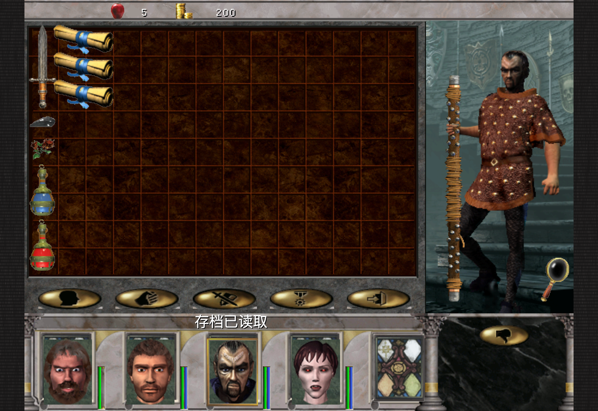

# 228：双手武器左臂接缝

修复历史083未关闭的左臂断口。原版无副手双手武器在护甲前使用LHo姿态列和LHf锚点；当前代码原先跳过这一层，转而在手指层使用LHu/LHo。现已在合成与备用两条路径恢复原顺序和锚点，覆盖所有Weapon2且实际副手槽为0的角色。没有角色专用偏移、补造图像、坐标表或装备规则改动。该角色LHu/LHo两列实际都指pc09LHu，修正的是锚点及遮挡顺序。

仅做一次13.725秒Mac Metal显示：读取未修改的081来源Save85副本，正常头像输入打开member2的背包，19帧输出一张图并退出。原角色character9、主手79、皮甲84、副手0直接来自原档；无新增队伍/装备/地图/位置/金钱/时间状态。gameplay delta0明确保留。图片已实际查看，旧断口消失。原档和副本SHA均未变，没有写档、装备往返或战役回放。

最终原生编译6.933秒、通用unsigned iOS编译8.522秒通过，两个源码摘要一致。较早一次5.340秒编译用于Staff限定分支；独立原exe静态核对证实所有无副手Weapon2共用同一路径后，在唯一App运行前重新编译。没有新增测试用例。其他体型/武器和fallback只接受源码及构建范围，不称为逐项像素或触控验收。

资源继续使用完整227及其累计增量，UiText214、Combat223、导航222、Save105不变，见[227说明](../equipment-feedback-227/README.md)。未新增Release或真机检查点，固定214/195/RC1–3保留。整体工程估算约85%、低置信度，完整自然通关仍未证明。下一项只核对同一原函数的长矛与副手分支，不重跑本次角色。
